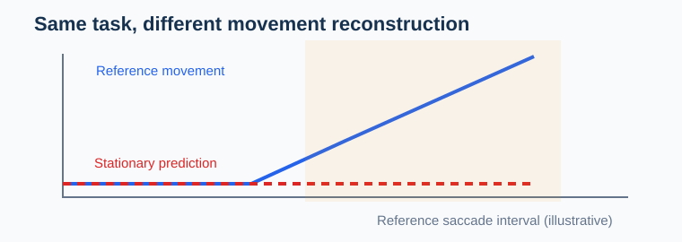

# Spatial accuracy is not event reconstruction

**Research implementation, October 2026.** Reference angles and labels must come from an independent, suitably synchronized source.

The experimental function `event_reconstruction_audit()` requires matched timepoints, participant/trial identity, gaze coordinates in **degrees** and reference fixation/saccade intervals. It reports mean and median angular error, fixation-centroid error, saccade-amplitude error and saccade-direction error.

## Run an intentionally bad model

~~~python
import pandas as pd
from research.october_2026.event_reconstruction import event_reconstruction_audit

reference = pd.DataFrame({
    "participant_id": ["P1"] * 6,
    "trial_id": ["T1"] * 6,
    "time_s": [0, 1, 2, 3, 4, 5],
    "x_deg": [0, 0, 0, 1, 2, 3],
    "y_deg": [0] * 6,
    "event": ["fixation"] * 3 + ["saccade"] * 3,
})
predicted = reference.drop(columns=["event"]).copy()
predicted["x_deg"] = 0  # Invalidly stationary model
result = event_reconstruction_audit(reference, predicted)
print(result["event_geometry"])
~~~

An apparent low average spatial error does not justify scanpath or saccade validity. A stationary predictor has zero reconstructed saccade amplitude and undefined direction. Undefined direction is retained as missing rather than replaced by an arbitrary zero.

## Original reproducible plot

~~~python
import matplotlib.pyplot as plt
fig, ax = plt.subplots(figsize=(7, 3))
ax.plot(reference.time_s, reference.x_deg, "-o", label="Reference")
ax.plot(predicted.time_s, predicted.x_deg, "--s", label="Stationary estimator")
ax.axvspan(3, 5, alpha=0.1, label="Reference saccade")
ax.set(xlabel="Synthetic time (s)", ylabel="Horizontal gaze (degrees)")
ax.legend()
fig.tight_layout()
~~~

`confidence_threshold_audit()` additionally reports acceptable-error fractions for a vendor score separately by participant. These empirical descriptive fractions are **not** calibrated cross-participant probabilities. Scores require real target-validation error records before any QC interpretation.

### Outstanding validation

Real reference-gaze datasets, calibration geometry, participant-disjoint uncertainty, event-boundary detection agreement and external-device checks are required before scientific promotion. The displayed curves are illustrative, not empirical gaze measurements.
